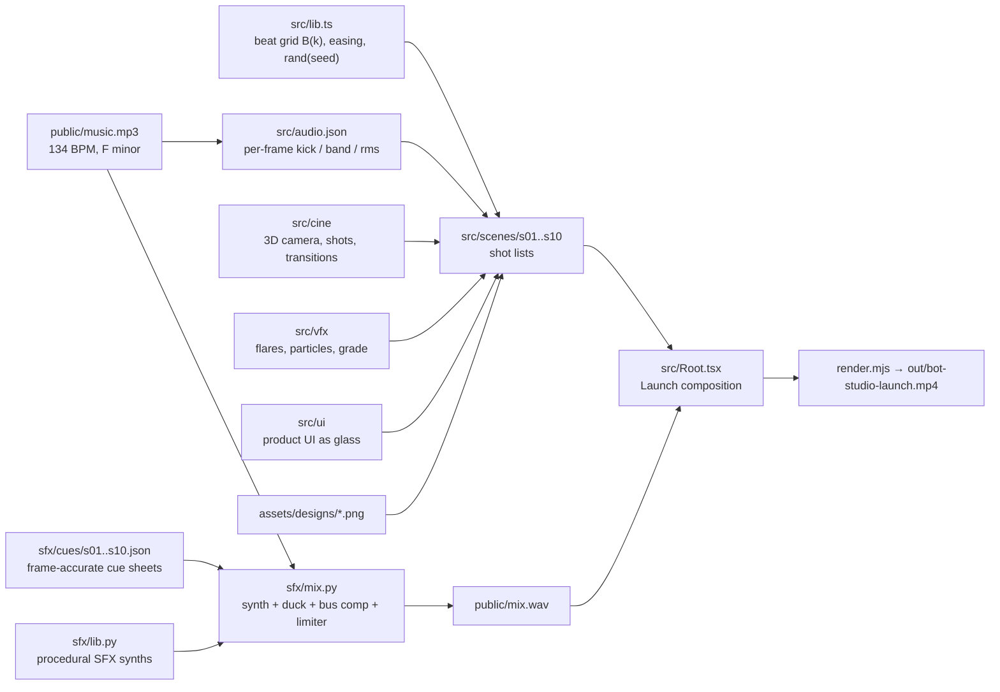

# Bot Studio — Launch Film

A 76.5-second, music-only, sci-fi launch film for **Bot Studio**, a bot builder built on Jev / TypeSafe. The whole film is **code**: no footage, no stock, no narration, no WebGL. Bot Studio's real interface is rebuilt as translucent glass and holographic layers floating in deep space, and every cut, impact and swoosh lands on a 134 BPM soundtrack.

▶️ **Watch / download:** [bot-studio-launch.mp4](https://github.com/aviz85/bot-studio-launch-video/releases/download/v1.0/bot-studio-launch.mp4) ([Release v1.0](https://github.com/aviz85/bot-studio-launch-video/releases/tag/v1.0))

| | |
| --- | --- |
| Format | 1920×1080 · 60 fps · 4,591 frames · H.264 + AAC |
| Engine | [Remotion](https://www.remotion.dev/) 4 (React → headless Chromium → ffmpeg) |
| Visuals | CSS 3D transforms, SVG, Canvas2D only (software-rendered, deterministic) |
| Audio | One music track + ~100% procedurally synthesized SFX (Python / NumPy / SciPy, no samples) |
| Made by | A team of 15 Claude agents working in parallel on one repo (see [How it was made](#how-it-was-made)) |

---

## Contents

1. [Quick start](#quick-start)
2. [How the film works](#how-the-film-works)
3. [Story and edit map](#story-and-edit-map)
4. [Project layout](#project-layout)
5. [Preview and check tools](#preview-and-check-tools)
6. [The rules that keep it reliable](#the-rules-that-keep-it-reliable)
7. [How it was made](#how-it-was-made)
8. [Further reading](#further-reading)
9. [Provenance and licensing](#provenance-and-licensing)

---

## Quick start

**Requirements:** Node 18+, `ffmpeg` on your `PATH`, Python 3 with `numpy` and `scipy`. For a frame-exact match with the release, install the fonts the film uses: **Inter**, **Inter Display**, **DejaVu Sans Mono**, **Noto Color Emoji**.

```sh
git clone https://github.com/aviz85/bot-studio-launch-video
cd bot-studio-launch-video
npm ci
pip3 install numpy scipy

npm run check          # TypeScript: must be 0 errors
python3 sfx/mix.py     # music + every SFX cue sheet → public/mix.wav
npm run render         # copies the design PNGs, then renders → out/bot-studio-launch.mp4
```

Want to look before committing to a full render (about 30 min on 4 cores)?

```sh
npx remotion studio src/index.ts                                   # interactive scrubbing in the browser
node tools/preview.mjs all --range 0-4590:27 --scale 0.4 --cols 8  # one frame per beat: the whole film on one contact sheet
```

`npm run render` (via `render.mjs`):

- copies `assets/designs/*.png` → `public/designs/` (the real Bot Studio screens used by the scene 5 editor and the scene 10 montage),
- decodes `public/music.mp3` → `public/music.wav` if it is missing,
- re-runs the sound mix when any cue sheet is newer than `public/mix.wav`,
- renders with `CONCURRENCY` browser tabs (default 4). Set `BROWSER_EXECUTABLE` to use a specific Chromium; otherwise Remotion uses its own headless shell.

Measured on the 4-core build box: a full render at concurrency 4 took **28 min** (≈0.37 s per frame) and produced an ≈800 MB master at CRF 16.

---

## How the film works



### 1. Everything hangs off the beat grid

The music is 134 BPM. `src/lib.ts` defines one beat = 0.44776 s ≈ 26.87 frames at 60 fps, and `B(k)` returns the global frame of beat `k`. Every scene boundary, cut, title and impact is written in beats (`B(32)`, `B(104.5)`…), never as hand-typed frame numbers, so the edit can't drift away from the music.

The three big moments are the drops: **frame 860** (beat 32, the reveal), **2794** (beat 104, the Live Dashboard) and **4298** (beat 160, the final hit).

### 2. The picture: ten scenes in one composition

`src/Root.tsx` registers a single Remotion composition called `Launch`. It places the ten scenes in `<Sequence>`s at the beat ranges fixed in `src/scenes/registry.ts`, layers the `GlobalGrade` finishing pass (vignette, film grain, letterbox schedule) on top, and plays `public/mix.wav`.

Each scene is built from three shared libraries:

- **`src/cine`: the camera and the edit.** A CSS-3D `World`/`Obj` system with a keyframed camera (dolly, crane, orbit, whip pans), speed ramps, fake depth of field and motion blur, and a beat-accurate `Shots` sequencer with cut and transition types.
- **`src/vfx`: light and energy.** Anamorphic lens flares, shockwaves, particle fields, a `SpaceBackdrop` (nebula, dust, holo grid floor), HUD elements, and the global grade.
- **`src/ui`: the product as glass.** Bot Studio's real screens rebuilt from React components in two looks: *frost* (light translucent, true to the product) and *holo* (smoked glass, luminous content). This includes `GlassPane`, `HoloAppFrame`, the 3D `SignalBars3D` wall, `GlassOrbNode`/`HoloGraph` for the state graph, and the winking robot `Avatar`.

### 3. The picture listens to the music

`src/audio.json` is a per-frame analysis of the soundtrack (`kick`, frequency `band`s, `rms`). Scenes read it to make the Signal Wall pump, glows breathe and the camera push on kicks. All of this is a pure lookup by frame number, so it stays deterministic.

### 4. The sound: synthesized, not sampled

There are no sample files. `sfx/lib.py` is a library of procedural synthesizers (booms, whooshes, glass hits, zaps, scans, glitches, risers, UI blips…), all deterministic with a seed. Each scene owns a cue sheet, `sfx/cues/sNN.json`:

```json
{"frame": 860, "sfx": "boom", "gain_db": -2, "pan": 0, "params": {"pre": 0.0}}
```

`sfx/mix.py` renders every cue at its frame, snaps near-grid cues to the exact musical time, ducks the music under big hits, then bus-compresses and true-peak-limits the result into `public/mix.wav`. The full sound list is in [`sfx/CATALOG.md`](sfx/CATALOG.md).

**Sync detail:** the music's transients sit about 30 ms ahead of the mathematical beat grid, so the soundtrack is delayed by 2 frames (`AUDIO_DELAY_FRAMES` in `src/Root.tsx`). With that delay, all three drops land within ±10 ms of their flash cuts.

---

## Story and edit map

The emotional arc: **the old way is a black box → see it think → it's built, not prompted → it's alive → a bot that builds bots.**

| Scene | Beats | Frames | Music | What happens | Copy |
| --- | --- | --- | --- | --- | --- |
| s01 Black box | 0–16 | 0–430 | intro, no kick | A dull chat widget adrift; a colossal monolith of prompt text; it glitches and dies like an old TV | "You know chatbots." · "One giant prompt." · "Why did it say that?" |
| s02 See it think | 16–32 | 430–860 | half-time build, snare roll, near silence | Giant type on a holo floor, a dive into the light, a strobe montage of teasers, then a single charging glint | "What if you could see it think?" · "Introducing" |
| s03 Reveal | 32–40 | 860–1075 | **drop 1** | Flare explosion and shockwave; the avatar forms from glass shards; the app assembles from exploding glass layers | "Bot Studio" · "Bots that think in the open." |
| s04 Build with AI | 40–52 | 1075–1397 | drop 1 groove | A prompt is typed; "Build a proposal" bursts; 4 states / 6 judgments / 5 policies slam in | "Describe it." · "Get a whole bot." |
| s05 States | 52–64 | 1397–1719 | | A holographic state graph of glass orbs, branches and cycles; a light token flies the path | "Map every step. Branch anywhere." |
| s06 Minds & judgments | 64–80 | 1719–2149 | | Judge, Speaker and Clerk monoliths fire into one runtime core; the Judgment editor in macro | "Three minds. One runtime." · "Measure meaning. Get typed signals." |
| s07 Rules & real work | 80–96 | 2149–2579 | fills | A policy assembles like a circuit; Clerk laser-scans fields; a function runs in a background lane | "Decide in rules you can read." · "Real tools. Running in the background." |
| s08 Live | 96–120 | 2579–3224 | breakdown, **drop 2** at 104 (2794) | Near silence, then the Live Dashboard: a 3D Signal Wall pumping to the music, exploded glass layers | "Not another chatbot." · "A bot studio." · "See every signal. Live." · "Every decision, explained." |
| s09 Conversation & code | 120–140 | 3224–3761 | drop 2 groove | Chat in 3D with instant reactions and a background booking; the turn timeline; BotScript projects into UI | "Reacts instantly. Talks naturally." · "Every millisecond, traced." · "One script. For people and agents." |
| s10 Factory & finale | 140–end | 3761–4591 | **final hit** at 160 (4298) | An infinite wall of glass bot cards; a montage of the real designs; logo, tagline and feature pills | "A bot that builds bots." · "Describe." "Build." "See." "Ship." · "Bot Studio" |

Scene boundaries are seamless: each scene renders one half of the transition (s06's last shot whips out, s07's first shot whips in), and each boundary SFX belongs to exactly one cue sheet. Timings and metrics shown on screen are illustrative, not benchmarks.

---

## Project layout

| Path | What it is |
| --- | --- |
| `src/index.ts` | Remotion entry point |
| `src/Root.tsx` | The `Launch` composition: ten `Sequence`s, the `GlobalGrade` pass, the audio and `AUDIO_DELAY_FRAMES` |
| `src/lib.ts` | Beat grid `B(k)`, `FPS`, `DURATION`, brand colours (Lilac Pop), fonts, easings, `prog()`, deterministic `rand(seed)`, audio-analysis helpers |
| `src/audio.json` | Per-frame analysis of the music (`kick`, `band`, `rms`) |
| `src/scenes/registry.ts` | The fixed beat range of each scene |
| `src/scenes/sNN.tsx` + `src/scenes/sNN/` | The ten scenes; the shot list is at the top of each file |
| `src/cine/` | Camera, keyframed paths, speed ramps, DOF, motion blur, masks, the `Shots` sequencer — [`docs/CINE.md`](docs/CINE.md) |
| `src/vfx/` | Flares, energy, particles, environment, HUD, post and the global grade — [`docs/VFX.md`](docs/VFX.md) |
| `src/ui/` | Product UI as frost/holo glass, app frame, screens, avatar, theme — [`docs/GLASS.md`](docs/GLASS.md) |
| `src/demos/` | Showcase sandboxes for the three libraries (`demo:cine`, `demo:vfx`, `demo:glass`) |
| `src/v1/` | The first version of the film, kept for reference |
| `sfx/lib.py` | Procedural SFX synthesizers (48 kHz, seeded) |
| `sfx/mix.py` | The mixer: cue rendering, grid snapping, ducking, bus compression, limiter |
| `sfx/check.py` | Cue-sheet validation helpers |
| `sfx/cues/sNN.json` | One cue sheet per scene (`_demo.json` for the library demo) — [`sfx/CATALOG.md`](sfx/CATALOG.md) |
| `public/music.mp3` | The soundtrack (134 BPM, F minor) |
| `assets/designs/*.png` | The 15 real Bot Studio design screens, copied to `public/designs/` by `npm run assets` |
| `render.mjs` | Full-film render (mix if stale → bundle → `renderMedia`) |
| `stills.mjs` | Quick half-scale JPEG stills: `npm run stills -- 860 2794 4298` → `out/stills/` |
| `tools/preview.mjs` | The main preview tool (stills, contact sheets, single scenes, short clips) |
| `docs/` | Director's brief, scene briefs, library docs and integration notes |

---

## Preview and check tools

```sh
node tools/preview.mjs all --frames 860,2794,4298 --scale 0.5        # stills of the whole film → out/preview/all/ + sheet.jpg
node tools/preview.mjs all --range 0-4590:27 --scale 0.4 --cols 8    # one frame per beat on one sheet
node tools/preview.mjs s05 --range 1397-1719:13 --grade              # one scene alone (+ the GlobalGrade pass)
node tools/preview.mjs all --video --range 2790-2900:1 --scale 1     # short mp4 clip with audio
node tools/preview.mjs demo:glass --frames 380,415                   # library showcases: demo:cine, demo:vfx, demo:glass

python3 sfx/mix.py --check                                           # validate every cue sheet
python3 sfx/mix.py --only s08 --audit                                # one scene's cues + per-cue audibility report
python3 sfx/mix.py --stems                                           # also write per-scene stems
```

Full-resolution stills cost more than a frame in a full render (mean ≈1.7 s, heaviest transition frames ≈3–3.7 s). Use them to find expensive frames, not to estimate render time.

---

## The rules that keep it reliable

- **Every frame is a pure function of the frame number.** No `Math.random()`, no `Date`, no timers; use `rand(seed)`. Remotion renders frames out of order across parallel tabs, so any hidden state would flicker.
- **Global frames everywhere.** All audio helpers and SFX cues use the global frame, never a scene-local one.
- **CSS 3D, SVG and Canvas2D only.** Rendering happens in software-rendered headless Chromium, so there is no WebGL. Big `filter: blur()`s are replaced with gradients to keep frame times sane.
- **Safe area.** Key text stays inside x 120–1800, y 130–950 so the letterbox never covers it.
- **The music map is fixed.** Scenes can't be re-timed; they have to land on the beats in `src/scenes/registry.ts`.

---

## How it was made

The film was produced by **15 Claude agents** working in parallel on one repository, each owning its own files so they never collided:

1. **Director.** Wrote the brief, the product truths, the style bible, the music map and the scene registry ([`docs/DIRECTION.md`](docs/DIRECTION.md), [`docs/SCENES.md`](docs/SCENES.md), `src/lib.ts`, `src/Root.tsx`).
2. **Four foundation agents.** Camera and transitions (`src/cine`), VFX (`src/vfx`), glass UI (`src/ui`) and sound design (`sfx/`). Each shipped a showcase demo and a doc.
3. **Ten scene agents.** One per scene (`src/scenes/sNN*` and `sfx/cues/sNN.json`). Each previewed its own range with `tools/preview.mjs` and reported cross-scene issues.
4. **Integration editor and re-recording mixer.** Whole-film review, seamless boundaries, shared-module fixes, the final SFX pass and mix, the global grade and render reliability ([`docs/INTEGRATION_NOTES.md`](docs/INTEGRATION_NOTES.md)).

The git history in this repo is the real production history, from the first Remotion skeleton to the final 2-frame audio sync fix.

---

## Further reading

| Doc | Read it for |
| --- | --- |
| [`docs/DIRECTION.md`](docs/DIRECTION.md) | The director's brief: feelings, product truths, style bible, music map, contracts |
| [`docs/SCENES.md`](docs/SCENES.md) | Original shot ideas per scene |
| [`docs/CINE.md`](docs/CINE.md) | Camera, shots and transitions API |
| [`docs/VFX.md`](docs/VFX.md) | Light, particles, environment and grade API |
| [`docs/GLASS.md`](docs/GLASS.md) | The glass/holo product UI kit |
| [`sfx/CATALOG.md`](sfx/CATALOG.md) | Every synthesized sound, its parameters and its sync point |
| [`docs/INTEGRATION_NOTES.md`](docs/INTEGRATION_NOTES.md) | Cross-scene problems and how they were solved |

---

## Provenance and licensing

This project was extracted, with its full commit history, from the `launch-video/` folder of the private Bot Studio product repository. The only outside input it needed (the design PNGs) now lives in `assets/designs/`, so this repo builds on its own.

The soundtrack (`public/music.mp3`) and the Bot Studio designs are included so the film can be reproduced. They are not offered for reuse.
